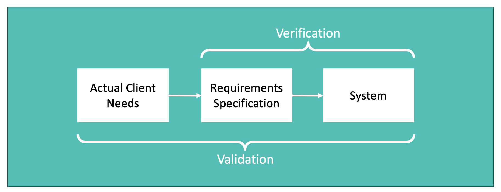
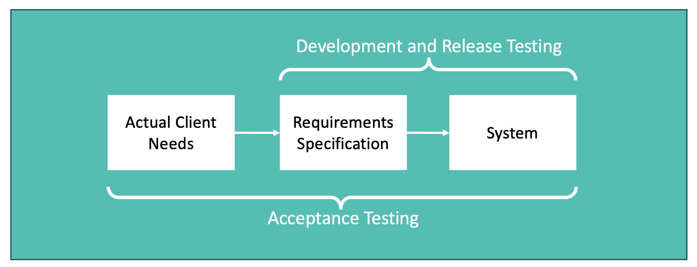
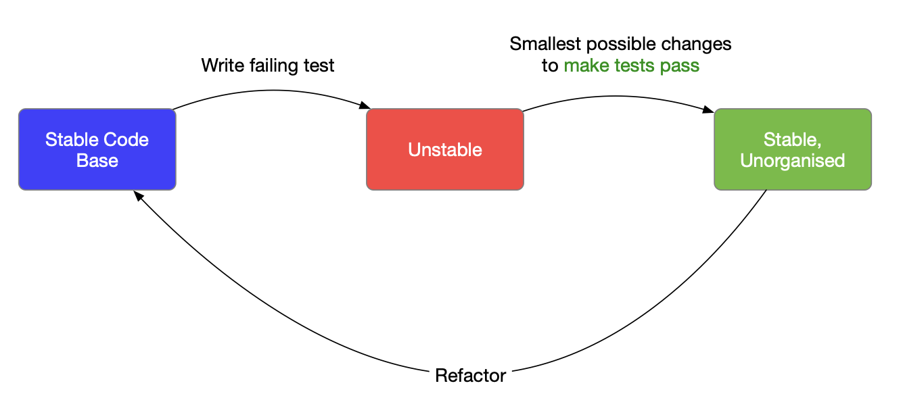

# Verification & Validation and Test Driven Development

In this workbook we will shift our focus to consider the twin topics of Verification and Validation. There are numerous issues to explore in this area and many of them are key to the successful development of software systems.

---

## Verification and Validation

There are subtle but important differences between the two concepts:

<table><tr><td>
<h3>Verification</h3>
<p>“Are we building the product right?”</p>
<p>Can we verify that a system is correct?</p>
<p>The software must conform to its specification</p>
<h3>Validation</h3>
<p>“Are we building the right product?”</p>
<p>Is our system a valid solution?</p>
<p>The software should do what users really want</p>
</td></tr></table>

Or in a visual form:



There are a number of different approaches to V&V:

- Manual audits and reviews
- Mathematical proofs
- Static code analysis
- [Heuristic evaluation](https://en.wikipedia.org/wiki/Heuristic_evaluation)
- User-centered evaluation
- Run-time testing

There are different phases of testing that you will need to understand - during Agile development, each of these should be used in every sprint:

- **Development testing**: the various bits (“units”) of the system are tested during development, so you can discover bugs and defects.

- **Release testing**: In industry, a separate testing team will test the complete version of a system as an integrated whole.

- **Acceptance testing**: client and users of a system assess it within their own environment, and report any issues back.



---

## What do we mean by testing?

This might seem obvious, but is always worth stating:

When you test, you execute a program, “exercising” it using synthetic data, and checking the results for errors and anomalies.

The **aim of testing** is to identify the presence of defects, so **a successful test** is one that finds a defect!

**HOWEVER**: absence of evidence is not evidence of absence!
"Testing shows the presence, not the absence of bugs" ([Edsger W Dijkstra](https://en.wikiquote.org/wiki/Edsger_W._Dijkstra), 1970)

We test to get confidence that the software meets requirements (which assumes we have a good understanding of what we're making!) and we test to show new changes don’t break existing code (regression testing).

For example, imagine a function that, if given a day, month and year, can tell you what day of the week it was. How do we know this is **completely** correct? We could run a program with a few arbitrary values, but it probably won't reveal many errors, as it wouldn't be methodical or systematic enough. So we need a proper, organised testing strategy.

### Black Box Testing

In Computer Science, a black box is a system where we can see inputs and outputs, but have no knowledge of any internal workings - imagine an opaque box with a keyboard attached, where you type a question and a piece of paper with an answer pops out of a slot.

In black box testing, components are viewed as black boxes, where we can't see the internal implementations - from reading the system's specification, we know the range of acceptable inputs and what the corresponding correct outputs should be, so any actual output that doesn't match the expected output indicates the existence of a defect.

When undertaking black box testing, we have to consider **coverage versus practicality**. As functions can have an infinite number of possible input values, **complete** black box testing would try every possible combination of every single input value, which isn't practical - in the 'days of the week' example, 100 years would require around 37k combinations!

So we need to identify a **sample set** of test cases, which ensures coverage, but is also practical.

### Equivalence partitioning

This is a technique to help create a systematic set of test cases. It is "a cluster of input values, for which a program should behave in the same way." For example, it might be a set of all positive numbers, as the number 54 is likely to have the same effect as 55.

Instead of testing every possible value or combination, partitions are tested. Each partition has an upper and lower boundary - and tests should also choose a data value from the main body of the values. These should be representative of the main body of the values.

So, for example, if we had a function to convert a grade, as a percentage into a degree classification (1st, 2:1, 2:2, 3rd, Fail), the equivalence partition might be as follows:


And the test case values might then be:

-10, -1, 0, 26, 39, 40, 43, 49, 50, 56, 59, 60, 63, 69, 70, 81, 100, 101

Of course, nothing in Computer Science is simple, so if we were taking the days of the week problem, we'd have some interesting test cases:

- Day: -30, -1, 0, 1, 15, 27, 28, 29, 30, 31, 32, 40
- Month: -12, -1, 0, 1, 6, 12, 13, 30
- Year: -2017, -1, 0, 00, 1, 17, 69, 70, 1969, 1970, 2000

That’s still 12 x 8 x 11 (over 1000) combinations! And that's before we get into the [falsehoods computer programmers believe about time](https://gist.github.com/timvisee/fcda9bbdff88d45cc9061606b4b923ca)!

## JUnit

**TODO: Make this general, rather than specific to Java**

If you're using Java, [JUnit](https://junit.org/) is a simple tool you can use. It provides a framework for writing and running your own test cases.

JUnit uses “Assertions” to test the code, which allow us to state what should be the case, and if assertions do not hold, JUnit’s logging mechanisms report failures. There are various types of assertion available - the most commonly used are:

- assertEquals( expected, actual )
- assertTrue( condition )
- assertFalse( condition )
- assertThat( value, matchingFunction )

## Test Driven Development

**Test Driven Development (TDD)** is a key practice common to numerous Agile methods, that puts testing at the heart of programming. It is an essential activity that, as a professional developer, you will need to master.

In TDD, we don't write the code and then write the tests - we write the tests *first* and make sure that all code that is written can pass these! Then, before we write the next piece of code, we write more tests, so that when we merge the new code, we know it will pass.

The ideal scenario is testing the smallest possible change first, so we can easily identify any issues - this is one of the reasons we want you to split your commits down into small, manageable chunks, that should include the test cases. TDD should look like this:

The **main steps of TDD** are:

1. Write tests based on user stories or detailed requirements
   - Focus on the requirements before writing the code

2. Focus implementation on the essentials
   - Don’t prematurely optimize

3. Re-run tests

4. When all tests pass: Refactor
   - Restructure, rename, remove duplication
   - Break functions, objects into more manageable chunks
   - Introduce interfaces, inheritance, new modules
   - Keep running tests
   - Refactor tests



<table><tr><td>
<h3>The Benefits of Test-Driven Development</h3>
<b>Code Coverage</b>
<p>We are sure that all code written has at least 1 test
<br>(If there was no test, the code wouldn't exist as it wouldn't have passed the test!)</p>
<b>Simplified debugging</b>
<p>If a test fails, we know it was caused by the last change</p>
<b>System documentation</b>
<p>Tests themselves are one form of documentation
<br>(they describe what the code should be doing)</p>
</td></tr></table>

## TDD in SEP

One of the important things is that tests should **NOT** just be written by the person writing the code - ideally different people write the tests, to get a better coverage. This also has the advantage that the whole team understands what the code is supposed to do.

**In SEP EVERYONE is expected to write tests** - this is one of the GitHub metrics we use to individualise your marks. It doesn't matter what features you are working on - you should all be writing tests for all parts of the system.

**If you're not sure how to write tests**, ask your team mates for help, ask your mentor, or come to the drop ins.

**When you write tests**, as with everything, record it on the Kanban board - we can't mark what we can't see!

## Code coverage

**[Code Coverage](https://www.atlassian.com/continuous-delivery/software-testing/code-coverage)** is a metric for how much of your code is executed by your tests. If big chunks of the code are missed by testing... we haven’t tested it properly! The higher the coverage, the more confident we are that the system operates as expected.

In reality, many businesses don't aim for 100% code coverage, but it is good practice to try to get as much of your code covered as possible. We might ask you in the viva what your code coverage is!

>[!NOTE]
> Companies often use 3rd party analysis tools to measure their code coverage
>
> You can find free examples - for example [JaCoCo](https://www.eclemma.org/jacoco/) is one for Java - **BUT** as always, use due diligence and check if something is reputable before you use it!
>
> You should not use paid-for tools for SEP - this is just information to be aware of.

## Limitations of TDD

There are some **limitations of TDD** that you should be aware of:
* Tests might be incomplete and the implementation could duplicate errors in the tests
* Tests need to be accompanied by code coverage reports so you understand what is and isn't being tested
* If tests fail, it is important to fix them! This might seem obvious, but it will take time.
* Maintaining tests can be expensive

## Task 1: Unit Testing

To start off on unit testing, use this task:

1. **Select a piece of Java code that you have written** (this might be on your current team project, or some code that you wrote previously).
2. **Pick a specific method/function**
3. **Identify some suitable test cases** that will fully exercise this code.
4. **Implement these test cases as [JUnit](https://junit.org/) tests** (or a similar alternative framework - if your code isn't written in Java!).

> [!TIP]
> If you are using Spring and have used **[Spring Initializr](https://start.spring.io/)** (or a similar project creation wizard) to create your project, you will notice that there is a `test` folder inside the `src` directory. This is where all of your testing code should be located.
>
> You will also find a test class that you can use to hold your unit test code.
>
> Add method calls in order to exercise your application code with suitable test data, using assertions to check the state of your application to determine that the code is behaving as expected.

---

## Task 2: Integration and Release Testing

Integration and Release testing operate at a higher level than the lower-level unit testing. The aim here is to test the system _as an integrated whole_ and thereby ensure that it is ready for release to a client.

This requires additional test cases to be written and executed that verify complex application features at a higher "whole-system" level (rather than just checking the operation of individual functions at a component/unit level).

<table><tr><td>
<h3>Integration Testing</h3>
<p>If unit testing tests how a single component of a system works on its own, integration testing tests how that component works in relation to all other components.
<br>Their execution often involves complex interactions - which we really should be attempting to test!</p>
<h3>Release Testing</h3>
<p>Release testing is the process of testing the full system <i>as an integrated whole</i> before a release.</p>
<p>But we must also show that the system delivers specified performance, dependability etc.</p>
<h3>User Story Driven Testing</h3>
<p>Stories identified during requirements and design phases can be used as a basis for release testing.</p>
<p>Each goal may involve several components.</p>
<p>Testing all goals also helps ensure good <i>coverage</i></p>
<h3>Nature of Test Cases</h3>
<p>Release testing is higher-level than unit testing
<br>Test cases are likely to involve complex data.</p>
<p>Running test cases can often be a manual activity - however automate wherever possible!</p>
<p>Tools like <a href="https://developer.ibm.com/articles/what-is-curl-command/">cURL</a> and Python <a href="https://pypi.org/project/requests/">Requests</a> can help
<br>They allow us to programmatically "call" HTTP APIs.</p>
</td></tr></table>

**To practice this**, use the [OpenStreetMap](https://www.openstreetmap.org/#map=6/54.91/-3.43) website, which provides an API that allows us to search for businesses in a particular geographical area. Use this to search for "grottos" in Bristol (although since it is still a while until Christmas, there might not be many). The following URL will query the OpenStreetMap API for grottos in Bristol:

[https://nominatim.openstreetmap.org/search?q=Bristol+grotto&format=json](https://nominatim.openstreetmap.org/search?q=Bristol+grotto&format=json)

**Write a few integration tests** that will exercise the OpenStreetMap API to make sure it is working correctly. This would involve making API calls using queries with known correct results (for example, businesses that you know exist and can check the postcode and/or geolocation details of).

> [!NOTE]
> Because this is live data, compare coordinates with a tolerance (e.g. within 0.01 degrees) rather than exact equality. Adding `&limit=1` or `&addressdetails=1` to your queries can be useful. Also try checking an error case (e.g. a missing `q` parameter) and a query with no results (which returns `[]`).

> [!TIP]
> A simple (if fairly rudimentary) way to make HTTP requests from a Java application (or JUnit test script) is by using the `HttpURLConnection` class.
>
> We can use this to call the HTTP request handlers provided by an application, and then use assertions as normal to check the response received.
>
> For example, we could write the following code to exercise the `search` request handlers provided by OpenStreetMap:

```java
URL url = new URL("https://nominatim.openstreetmap.org/search?q=Bristol+grotto&format=json");
HttpURLConnection connection =(HttpURLConnection)url.openConnection();
connection.setRequestMethod("GET");
connection.setRequestProperty("User-Agent", "SEP-teaching-test/1.0");
InputStream stream = connection.getInputStream();
BufferedReader reader = new BufferedReader(new InputStreamReader(stream));
String response = reader.readLine();

// Then check the response using JUnit assertions!
```

> [!IMPORTANT]
> Nominatim's [usage policy](https://operations.osmfoundation.org/policies/nominatim/) requires an identifying `User-Agent` header (requests using a generic Java one can get an HTTP 403 response), and allows a maximum of 1 request per second. Pause between requests in your tests, e.g. with `Thread.sleep(1100)` in a `@BeforeEach` method.

---

## Task 3: Partial Integration Testing

Firing up an entire heavy-weight application in order to test it can be a slow process, especially if you are doing this frequently (as you should be doing with Test Driven Development).

There is however a faster way, whereby you only need to run certain elements that you actually want to test (rather than the entire application). This involves **Mocking** (or simulating) some of the elements of the Model-View-Controller infrastructure.

If you're using Spring, it provides a `MockMvc` class to aid with this process. Take a look through [this tutorial on MockMvc](https://spring.io/guides/gs/testing-web/) for more details. You may wish to return to this tutorial at a later date, in order to integrate these features into your development process.

> [!NOTE]
> Although mocking allows for faster testing, it is important to remember that this isn't actually _full_ integration testing (after all, you aren't actually testing the entire integrated application).
>
> This kind of _partial_ integration testing can however speed up the testing process by initiating only those components that you wish to test at that point in time.

---

## Behaviour-Driven Development

In SEP we are asking you to use Test-Driven Development (TDD) for your project, but we want you to also be aware of **Behaviour-Driven Development** (BDD).

BDD is an evolution of TDD, aimed at improving communication between people with technical skills, like developers, and people without, like clients, and stakeholders within and outside a company, so that there can be improved collaboration and more efficient working. The idea is that tests are written in natural language, built around user stories, and helping create a shared understanding of what the system should do.

We don't expect you to use BDD in your project, but if you're interested in finding out more, there is an article that explains the concept by [Cucumber](https://cucumber.io/docs/bdd/), a widely used BDD tool, and (of course) a [Wikipedia article](https://en.wikipedia.org/wiki/Behavior-driven_development).
