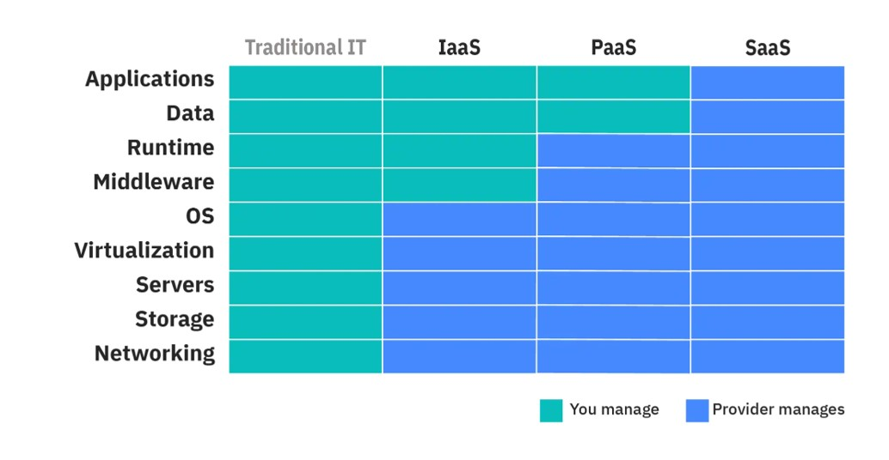

# Cloud
This week we will learn about Cloud and AWS services in particular. 

## Cloud and AWS

Most of you will want to use Cloud services in some way.  We use Amazon Web Services Cloud.  But there are some important things to remember, especially in how to set up your Cloud system. 

### AWS Induction

**Please read these slides first!**  They introduce AWS and how it is used on SEP.

If you can't open the slides in the workbook, click into the [resources folder](https://github.com/spe-uob/SEP2026/tree/main/Weekly%20Workbooks/07%20Cloud/resources) of this workbook and download the slides: AWS Induction.pdf

### Different types of Cloud services

In SEP, you will be using IaaS or PaaS

#### Infrastructure as a Service (IaaS):
Virtual machines, storage, and networking resources are available for you to manage and configure as needed. It's like having a virtual data centre in the cloud. 
With IaaS you can configure and control the infrastructure, install and manage software and have full control over your resources as if you were managing physical hardware, without the need to maintain it.

#### Platform as a Service (PaaS): 
AWS provides pre-configured platforms for application development, reducing the need to manage underlying infrastructure. Examples include AWS Amplify for web applications and AWS Lambda for serverless computing.

With PaaS, on top of IaaS tools, tasks such as operating system management, scalability and security are managed for you.

#### Software as a Service (SaaS): 
AWS does not specialize in offering SaaS. The most well-known example would be Microsoft’s Azure. Azure hosts and manages software applications that users can access over the internet, such as Office 365.

With SaaS, fully fledged software is delivered to the end-user/developer, usually through a browser.

# 
###  AWS briefing - services you can use with AWS Cloud

**Please read these slides!**  These lay out different services AWS provide for you and when you might use them. 

As always, if you can't open the slides in the workbook, click into the [resources folder](https://github.com/spe-uob/SEP2026/tree/main/Weekly%20Workbooks/07%20Cloud/resources) of this workbook and download the slides: CLOUD.pdf

#
###  AWS briefing - how to set up your Cloud account
  
 

**Please read both sets of slides!** These include an overview of the AWS services, what resources you have available to you and instructions on how to set up your account.  

As above, if you can't open the slides in the workbook, click into the [resources folder](https://github.com/spe-uob/SEP2026/tree/main/Weekly%20Workbooks/07%20Cloud/resources) of this workbook and download the slides:  AWS1.pdf and AWS2.pdf. 

> [!IMPORTANT]
> **DO NOT SPEND YOUR OWN MONEY ON SEP!!**
>
> **DO NOT PUT YOUR CREDIT/DEBIT CARD DETAILS INTO AWS! !**

# 
### To set up your Cloud account

> [!NOTE]
> This year all teams are being given blanket access to AWS, so you do **not** need to apply for an account.  Only one member of each team will be given access, and that person must add all other team members (see the first cloud task below).

Once your AWS account is set up, you will have a budget set for you. This will be monitored, and if you exceed your budget, you will have **restrictions** placed on your account, but your work will not be deleted. 

**If you realise you will exceed your budget [email the Unit Director](mailto:Daniel.Schien@bristol.ac.uk) immediately.** 

#### Cloud Task 1

As the **first cloud task**, the team member who has been given access must give **all** of their team mates admin access to the account, so that every team member can get in.

Once everyone has access, work through the AWS tutorial "Build a web app with S3, Lambda, API Gateway and DynamoDB" together as a team: [Build a web application](https://docs.aws.amazon.com/hands-on/latest/build-web-app-s3-lambda-api-gateway-dynamodb/build-web-app-s3-lambda-api-gateway-dynamodb.html?ref=gsrchandson) .  When you have finished, remember to delete the resources you created so you don't use up your budget.

> [!WARNING]
> **You will have a limited AWS budget and are responsible for spending these wisely**
>
> **NEVER add your own credit/debit card!**  Almost all activities use credit - it is very easy to build up charges
>
> **Remember to delete resources that are not in use, so you don't get charged for them!**

